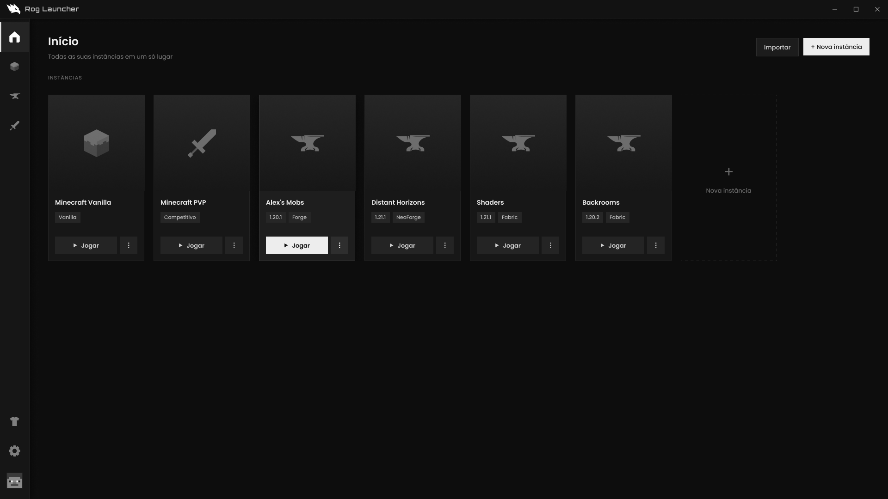

# Rog Launcher

A lightweight, free launcher for **Minecraft: Java Edition**, built with [Tauri](https://tauri.app) (Rust + web UI).

> Status: early development. The UI is designed in Figma and the app is being built now.



## Planned features

- **Instances** — separate game folders for Vanilla, modded and PvP setups, each with its own settings.
- **Vanilla** — pure Minecraft, with the option to add mods later without moving your worlds.
- **Mods** — install Fabric, Forge, NeoForge or Quilt and add mods from Modrinth.
- **PvP** — pick a combat version (1.8 to 1.21) and an optimization module (OptiFine or Fabric + Sodium).
- **Skins** — a global skin, plus an optional per-instance skin applied automatically when you hit Play.
- **Microsoft sign-in** — official OAuth device-code flow on Microsoft's own page; the launcher never sees your password.
- **Import / export** — `.mrpack` (Modrinth), CurseForge `.zip`, raw `.zip`, and instances from other launchers.
- **Game tools** — download progress, live console, force-close ("Kill game") and crash screen with the log.

## Tech stack

| Part | Choice |
| --- | --- |
| Desktop shell | Tauri 2 |
| Backend | Rust (downloads, Java/process management, auth) |
| UI | React + TypeScript + Tailwind |
| Mods source | Modrinth API |

## Development

Requirements: [Node.js 22](https://nodejs.org), [Rust](https://rustup.rs) and the [Tauri prerequisites](https://tauri.app/start/prerequisites/) for your OS.

```bash
npm install
npm run tauri dev     # app window with hot reload
npm run dev           # UI only, in the browser (http://localhost:1420)
npm run tauri build   # installer in src-tauri/target/release/bundle
```

Every push to `main` builds a Windows installer in GitHub Actions (download it from the run's artifacts).

## Privacy

Rog Launcher signs players in only to verify game ownership and launch Minecraft in online mode. It stores only the tokens needed to launch the game, on the user's own computer, and shares no account data.

## Disclaimer

Rog Launcher is not an official Minecraft product and is not approved by or associated with Mojang or Microsoft. Minecraft is a trademark of Mojang Synergies AB.

## Download

Get the latest version at **[louitaquete.github.io/rog-launcher](https://louitaquete.github.io/rog-launcher/)** or on [GitHub Releases](https://github.com/louitaquete/rog-launcher/releases).

## Code signing policy

Windows releases are built exclusively by GitHub Actions from this public repository.

Free code signing provided by [SignPath.io](https://about.signpath.io/), certificate by [SignPath Foundation](https://signpath.org/).

- Committers and approvers: [louitaquete](https://github.com/louitaquete)
- Privacy: this program does not transfer any information to other networked systems unless specifically requested by the user (login, downloads, mods and updates). See the [privacy policy](https://louitaquete.github.io/rog-launcher/privacy.html).

## License

[MIT](LICENSE)
